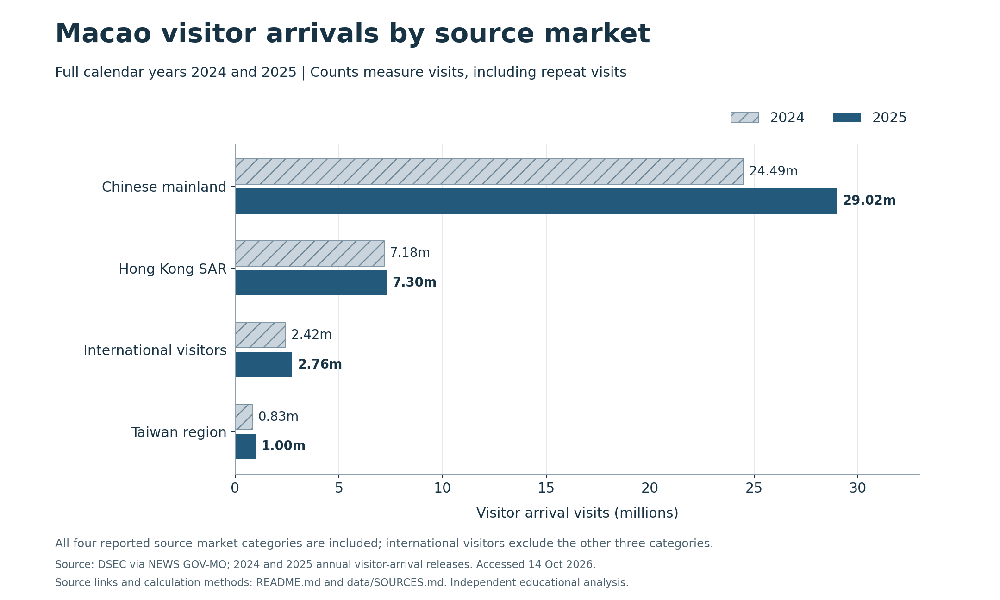
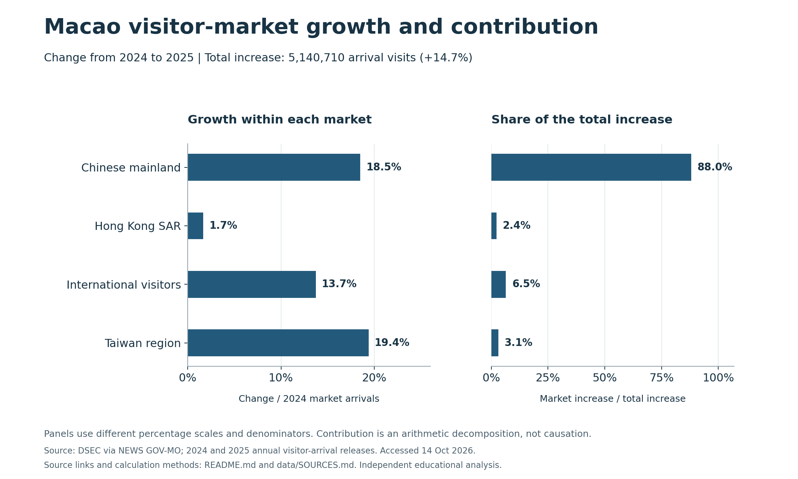

# Macao visitor source markets, 2024–2025

A reproducible descriptive analysis for **CISC7204 Practice 09**. The project extends an earlier course visualization into a small, inspectable Python repository with attributed source data, two complementary figures and explicit calculation checks.

## Research question

**How did Macao's visitor source-market mix change between 2024 and 2025, and which markets accounted for the increase in arrivals?**

The intended audience is a tourism or marketing analyst comparing market scale and growth. Arrival counts help frame demand; they do not by themselves justify an advertising budget or establish customer value.

## Dataset and usage permissions

The input has **8 rows: 4 source-market categories × 2 complete calendar years**. Counts were transcribed from official Statistics and Census Service releases on NEWS GOV-MO, initially obtained on 6 October 2026 and checked again on 14 October 2026:

- [2024 annual visitor arrivals](https://www.gcs.gov.mo/news/detail/en/N25AUB2Zwi), published 21 January 2025.
- [2025 annual visitor arrivals](https://www.gcs.gov.mo/news/detail/en/N26AWC98hd), published 23 January 2026.

The [source terms](https://www.gcs.gov.mo/news/terms/en) allow attributed noncommercial reproduction and calculations with methods identified. This educational use retains the original counts and records the acquisition dates. Commercial reuse and third-party materials have separate conditions. See [data/SOURCES.md](data/SOURCES.md) for attribution, field definitions and the precise scope; the data are not represented as unrestricted public-domain material. No personal or sensitive records are included.

## Methods and tools

Python, Pandas and Matplotlib validate the CSV, reshape it by market, calculate changes and export charts. No predictive model or significance test is fitted to these eight aggregate observations.

For a market with counts `A2024` and `A2025`:

| Measure | Calculation |
|---|---|
| Absolute increase | `A2025 − A2024` |
| Growth rate (%) | `(A2025 − A2024) / A2024 × 100` |
| Annual market share (%) | `market arrivals / total annual arrivals × 100` |
| Share change (percentage points) | `share2025 − share2024` |
| Contribution to total growth (%) | `market increase / (total2025 − total2024) × 100` |

All four mutually exclusive source-market categories are retained. Annual totals are cross-checked against the two source releases. Shares and growth contributions must each sum to 100%, within numerical precision. Contribution describes an accounting identity, not a causal explanation.

## Results

### 1. Market scale



Arrivals increased from **34,928,650 to 40,069,360**, a gain of **5,140,710 visits (+14.7%)**. The Chinese mainland remained the largest source market and its share rose from **70.12% to 72.42%**. The bars start at zero; hatching and direct labels distinguish years without relying on color alone.

### 2. Growth rate versus contribution



The Taiwan region had the highest proportional growth (**19.4%**), but the much larger mainland market accounted for **88.0%** of the total increase. International arrivals grew **13.7%**, while their share edged down from **6.94% to 6.88%**. A growing segment can therefore lose share when the whole market grows faster. The two panels have different denominators and clearly labeled scales.

For marketing planning, these results suggest examining mainland demand alongside the growth of smaller markets. A budget decision would additionally require visitor spending, trip purpose and acquisition-cost evidence.

## Limitations and next steps

Two annual observations per category cannot reveal seasonality, within-market country differences or the causes of change. The international category is aggregated. These are **visits, not distinct people**, and contain no spending or conversion measures. Findings describe the 2024–2025 comparison, not current 2026 conditions. A useful extension would add monthly series, overnight/same-day splits and expenditure metrics while preserving compatible definitions.

## Reproduce

Tested with Python **3.13.9**, Pandas **2.3.3** and Matplotlib **3.10.6**. From the repository folder:

```bash
python -m venv .venv
source .venv/bin/activate
python -m pip install -r requirements.txt
python src/analyze.py
```

On Windows, use `.venv\Scripts\activate` for activation. An existing environment with the required packages can run the last command directly. The analysis itself runs offline from the included CSV; it does not need credentials or a remote service.

Running the script regenerates the two figures in PNG and SVG, the exact comparison table, a summary and numeric-validation results in `outputs/`. Paths are resolved relative to the script, so running it from another working directory also works. To preserve the committed outputs while experimenting:

```bash
python src/analyze.py --output-dir /path/to/new-output-folder
```

## Repository guide

```text
data/visitor_arrivals_2024_2025.csv  Attributed source counts
data/SOURCES.md                    Provenance and usage conditions
src/analyze.py                     Validation, analysis and plotting
requirements.txt                  Tested direct dependencies
outputs/                          Two figures, table and validation results
```

AI assistance was used for code preparation, documentation and validation. The analysis is reproducible from the included source counts; the outputs do not establish independent student mastery or an official assessment result.
